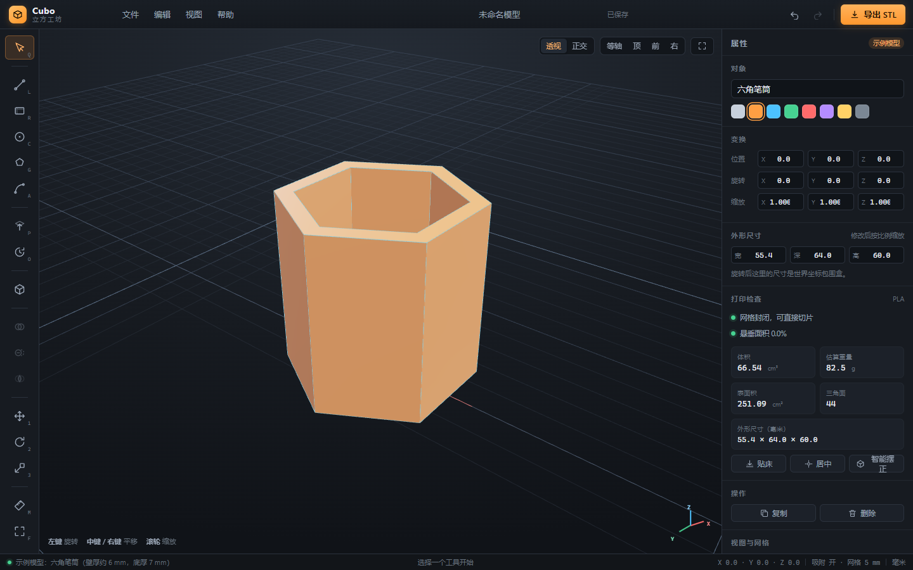

# Cubo 立方工坊

一个跑在浏览器里的 **3D 实体建模工具**，面向 3D 打印。工作流接近 SketchUp：画轮廓 → 推拉成体 → 布尔修改；几何内核使用 [Manifold](https://github.com/elalish/manifold)，所以导出的 STL 天生是封闭、法线朝外的流形网格。



---

## 立即使用

### 方式一：双击单文件（推荐，零安装）

双击项目根目录的 **`Cubo.html`**（或 `启动 Cubo.cmd`）。

- 单文件约 1.45 MB，Three.js、几何内核 WASM、全部代码都内联在里面；
- 不需要 Node、不需要联网、不需要起服务器；
- 模型的所有计算都在本机浏览器完成，不会上传任何数据。

### 方式二：开发模式

需要 Node.js 20.19+ 与 pnpm：

```bash
pnpm install
pnpm dev          # http://127.0.0.1:5273
```

修改 `src/` 下的代码会热更新。

第一次打开时，空场景提示卡片上有个 **「示例模型」** 按钮，点一下会载入一个用布尔运算做出来的六角笔筒，可以直接导出 STL 试切片。

---

## 能做什么

### 建模

| 类别 | 工具 |
| --- | --- |
| 草图 | 直线（连续折线）、矩形、圆、正多边形、三点圆弧 |
| 成体 | 推拉（拉伸）、旋转体（绕 Z 轴） |
| 图元 | 立方体、圆柱、圆锥、球体、圆环、圆管、六棱柱 |
| 布尔 | 并集、差集、交集 |
| 编辑 | 选择 / 多选、移动、旋转、缩放（gizmo + 数值输入）、复制、删除、改名、改色 |
| 测量 | 点到点距离 |

### 建模手感

- **在实体表面上直接画图**：第一个点落在哪个面上，草图就贴在哪个面上；往外拉是「长肉」（并集），往里推是「挖洞」（差集），和 SketchUp 的推拉一致。
- **网格吸附**：默认 5 mm 网格，可在右侧切换 1 / 2 / 5 / 10 / 20 mm；也会吸附到当前草图的已有顶点。
- **数字精确输入**：拉伸时直接敲数字 + 回车，就能得到精确高度；连续画直线时也可以敲长度。
- **撤销 / 重做**：最多 60 步，所有几何操作、布尔、变换、改色都会进历史。
- **打开 / 保存工程**：`.cubo.json`，保存的是每个实体的局部网格 + 变换，重新打开后还能继续改数值。

### 3D 打印

- 单位固定为 **毫米**，世界坐标系 **Z 轴朝上**；
- 打印体检：是否封闭、体积、表面积、外形尺寸、三角面数、估算重量、悬垂面积占比；
- 一键 **贴床**、**居中**、**智能摆正**（自动挑最大平面转向下，再贴床居中）；
- 导出 **二进制 STL**（推荐）或 ASCII STL，可只导出选中实体；
- 也可以导出 **OBJ**；
- 导入 STL 时自动焊接重复顶点，再交给 Manifold 校验；不是封闭实体的 STL 会给出明确提示。

耗材预估支持 PLA / PETG / ABS / TPU / 尼龙 / 光敏树脂，密度内置在 `src/print.js`。

---

## 五分钟上手

### 1. 画一个方块

1. 左侧点 **矩形**（或按 `R`）；
2. 在地面上点两个对角点；
3. 鼠标上下移动，看到绿色幽灵体；
4. 点击确认。想精确指定高度？直接敲 `25` 回车。

### 2. 挖一个孔

1. 点 **圆**（`C`）；
2. 在方块顶面点圆心，再点圆周——草图会自动贴到顶面上；
3. 鼠标往下拖（高度变负，幽灵体变红）；
4. 点击确认，孔就挖好了。

### 3. 布尔

选中两个实体（`Shift` 点选或 `Ctrl+A` 全选），右侧属性面板点 **并集 / 差集 / 交集**。差集规则是「最先选中的实体」减去其余实体。

### 4. 旋转体

按 `O`，截面画在**前视平面**上（X 是半径、Z 是高度），点回起点闭合后自动绕 Z 轴转 360°。适合做轴套、法兰、圆环类零件。

### 5. 导出打印

点右上角 **导出 STL**，选择范围和格式即可。默认二进制 STL，文件小、切片软件读得快。

---

## 快捷键

| 操作 | 快捷键 |
| --- | --- |
| 选择 | `Q` |
| 直线 / 矩形 / 圆 | `L` / `R` / `C` |
| 多边形 / 圆弧 | `G` / `A` |
| 推拉 | `P` |
| 旋转体 | `O` |
| 移动 / 旋转 / 缩放 | `1` / `2` / `3` |
| 测量 | `M` |
| 适配窗口 | `F` |
| 撤销 / 重做 | `Ctrl+Z` / `Ctrl+Y` |
| 复制 / 删除 | `Ctrl+D` / `Delete` |
| 全选 | `Ctrl+A` |
| 保存工程 / 打开工程 | `Ctrl+S` / `Ctrl+O` |
| 新建工程 | `Ctrl+N` |
| 取消当前操作 | `Esc` |
| 闭合轮廓 / 确认拉伸 | `Enter` |
| 精确输入 | 直接敲数字 |
| 强制生成独立实体 | `Alt` + 点击确认拉伸 |

视图操作：**左键拖动**旋转，**中键 / 右键拖动**平移，**滚轮**缩放。

---

## 项目结构

```
Cubo.html                 构建出的离线单文件（可直接双击）
index.html                开发入口
src/
  main.js                 启动：解码内嵌 WASM、创建 App
  app.js                  应用状态、实体管理、撤销栈、文件读写
  kernel.js               Manifold 封装：图元 / 拉伸 / 旋转 / 布尔 / 网格转换
  solid.js                实体对象：几何 + 显示对象 + 变换缓存
  viewport.js             Three.js 场景、两套相机、gizmo、拾取、灯光
  sketch.js               草图平面、吸附、轮廓构造、草图预览渲染
  tools.js                鼠标/键盘交互状态机（选择、绘制、推拉、测量）
  stl.js                  STL 二进制/ASCII 导出、OBJ 导出、STL 解析与焊接
  print.js                打印体检、悬垂分析、贴床/居中/智能摆正
  ui.js                   工具栏、属性面板、菜单、对话框、Toast
  styles.css              全部界面样式
  icons.js                内联 SVG 图标
  generated/
    manifold-wasm.js      WASM 的 base64 内嵌版本（脚本生成）
  shims/
    node-module.js        浏览器里 node:module 的替身
scripts/
  embed-wasm.mjs          从 node_modules 重新生成 base64 WASM 模块
  build-single.mjs        Vite 构建 + 资源内联 → Cubo.html
tests/
  kernel.test.mjs         几何内核单元测试（22 项）
  e2e-*.mjs               Playwright 端到端测试
```

---

## 开发与测试

```bash
pnpm install
pnpm dev                  # 开发服务器
pnpm test                 # 内核单元测试（Node + WASM）
pnpm test:e2e             # 端到端测试（需要先启动 dev server）
pnpm build:single         # 重新生成 Cubo.html
pnpm embed:wasm           # manifold 升级后重新生成 base64 内嵌模块
```

端到端测试用系统自带的 Edge（`playwright-core`，不额外下载浏览器），覆盖：

- 启动与界面渲染；
- 放图元、布尔并集、矩形推拉、导出 STL、撤销重做；
- 在表面挖孔、旋转体、属性面板改位置、STL 导入、工程保存/载入；
- gizmo 位移/旋转/缩放的矩阵运算、测量、数字精确拉伸、多边形、差集、贴床居中；
- 折线闭合、圆弧、正交投影、智能摆正、快捷键；
- 用 `file://` 打开单文件后完整初始化。

截图会输出到 `shots/`。

---

## 已知限制

- 目前是**实体级**布尔，没有 B-rep 面编辑，不能像 SolidWorks 那样直接点某个面做抽壳/倒角；
- 没有圆角、倒角、抽壳、阵列、放样、扫掠；
- 草图平面只能是平面，不能画在曲面上（点在球面/圆柱侧面会得到切平面）；
- 导入的 STL 必须是封闭流形，否则只能查看、不能参与建模；
- 缩放仅支持正数，镜像需要后续单独实现（负缩放会让法线翻转）；
- 多选时只做布尔/删除/复制，变换 gizmo 一次作用一个实体。

这些都在后续计划里；当前版本优先保证「画得出来、导得出去、打得出来」。

---

## 技术栈

- **Three.js 0.186**：渲染、拾取、TransformControls、RoomEnvironment；
- **Manifold 3.5（WASM）**：流形实体建模与布尔运算；
- **Vite 8**：开发服务器与构建；
- **Playwright（playwright-core）**：端到端测试，复用系统 Edge。

单文件版本里 WASM 以 base64 内嵌、通过 `wasmBinary` 直接实例化，因此 `file://` 下也不需要任何网络请求。
