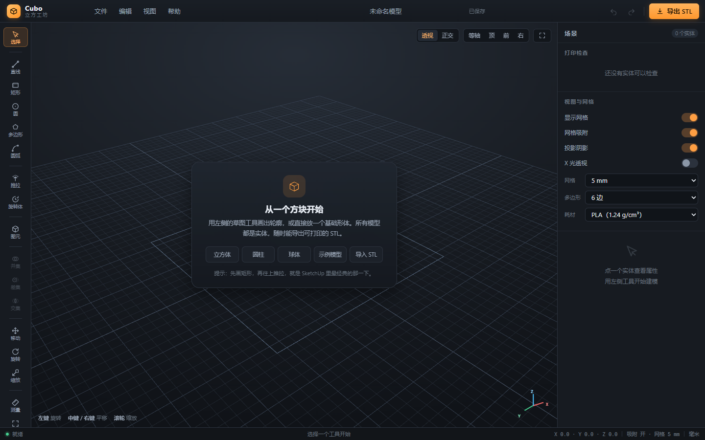

# Cubo 立方工坊

一个跑在浏览器里的 **3D 实体建模工具**，面向 3D 打印。工作流接近 SketchUp：画轮廓 → 推拉成体 → 布尔修改；几何内核使用 [Manifold](https://github.com/elalish/manifold)，导出的 STL 天生是封闭、法线朝外的流形网格。


---

## 立即使用

### 方式一：双击单文件（推荐，零安装）

双击项目根目录的 **`Cubo.html`**（或 `启动 Cubo.cmd`），推荐用 Edge / Chrome 打开。

- 单文件约 1.45 MB，Three.js、几何内核 WASM、全部代码都内联在里面；
- 不需要 Node、不需要联网、不需要起服务器；
- 所有计算都在本机浏览器完成，模型不会上传到任何地方。

### 方式二：开发模式

需要 Node.js 20.19+ 与 pnpm：

```bash
pnpm install
pnpm dev          # http://127.0.0.1:5273
```

修改 `src/` 下的代码会热更新。

第一次打开时，空场景卡片上有个 **「示例模型」** 按钮，点一下会载入一个用布尔运算做出来的六角笔筒，可以直接导出 STL 试切片。

---

## 界面导览



| 区域 | 作用 |
| --- | --- |
| 左侧工具栏 | 所有建模工具。**图标下方有中文名，鼠标悬停 0.2 秒会弹出完整说明和快捷键**（见下图）。 |
| 中间视口 | 3D 工作区。左键拖动旋转，中键/右键拖动平移，滚轮缩放。 |
| 右上角 | 透视/正交切换、等轴/顶/前/右视图、适配窗口。 |
| 右侧属性面板 | 选中对象的名称、颜色、位置/旋转/缩放、外形尺寸、打印体检、贴床/居中/摆正、镜像/阵列。 |
| 底部状态栏 | 当前操作、坐标、吸附状态；切除时会显示「切除深度 / 实体厚度」。 |


---

## 五个概念

1. **草图**：在平面（地面或实体表面）上画出的闭合轮廓。所有草图点都落在平面内，用网格吸附定位。
2. **实体**：草图拉伸出来的、或直接放置的封闭几何。Cubo 里所有模型都是实体，不是空壳面片。
3. **推拉**：把轮廓沿平面法线拉出厚度。画在实体表面上时，往外拉是**合并**，往里推是**挖孔**。
4. **布尔**：并集 / 差集 / 交集。差集规则是「最先选中的实体」减去其余实体。
5. **世界坐标**：Z 轴朝上、单位毫米（mm），和 3D 打印机的习惯一致，导出 STL 时不再缩放。

---

## 教程

### 1. 画一个精确尺寸的方块

1. 左侧点 **矩形**（快捷键 `R`）。
2. 在地面点第一个角，再点对角。轮廓闭合后会自动进入推拉预览。
3. 上下移动鼠标，看到半透明的绿色预览体。
4. 想精确指定高度：直接敲 `25`，输入框出现后按回车。
5. 也可以先随便点一下确认，再在右侧「外形尺寸」里改宽/深/高。

> 小技巧：右侧的「外形尺寸」是**等比缩放**，改宽度时厚度和高度也会跟着变。要单独改某一轴，用「变换 → 缩放」。

### 2. 挖一个贯穿孔

1. 点 **圆**（`C`）。
2. 鼠标移到方块**顶面**上点圆心——草图会自动贴在这个面上；再点圆周确定半径。
3. 鼠标往下拖，预览体变红。状态条会显示 **切除 12.0 / 30.0 mm**。
4. 继续拖到接近实体厚度，会自动吸附成贯穿孔；也可以直接按 `T`，或点状态条上的 **「切穿」** 按钮。
5. 点击确认，孔就挖好了。


> 为什么以前挖不穿？两个原因都修好了：切削预览原先被实体挡住（现在半透明且始终可见）；草图平面有 1e-14 级浮点误差，贴着表面切会在孔底留一层零厚度面（现在贴合表面的推拉两端各多伸 0.2 mm）。

### 3. 用图元和布尔做一个零件

1. 点 **图元**，选立方体；再点一次图元，选圆柱。两个零件会自动错开一点位置。
2. 按 `Ctrl+A` 全选，点左侧 **差集**，得到一个「方块缺一角」的实体。
3. 如果只想保留重叠部分，点 **交集**；想把两块焊在一起，点 **并集**。

### 4. 旋转体

1. 按 `O` 进入旋转体工具。
2. 截面画在**前视平面**上：横向是半径（X），纵向是高度（Z）。
3. 点回起点闭合轮廓，自动绕 Z 轴旋转 360°。
4. 截面不贴轴（比如从半径 10 画到 30）就会得到圆筒；贴轴就是实心圆柱。

### 5. 镜像与线性阵列

- 选中实体 → 右侧「操作」→ **镜像**：选轴向和镜面位置，生成一份镜像副本。
- 选中实体 → **阵列**：选方向、总数量、间距，可勾选「合并成一个实体」。
- 菜单「编辑」里也有这两项。

### 6. 检查与导出

1. 右侧「打印检查」会实时显示：是否封闭、悬垂面积占比、体积、估算重量、表面积、三角面数、外形尺寸。
2. 点 **贴床** 把最低点放到 z=0；点 **居中** 把包围盒中心移到原点；点 **智能摆正** 自动挑最大的平面转向下再贴床。
3. 点右上角 **导出 STL**，选范围（全部/仅选中）和格式（二进制/ASCII）。
4. 需要看内部结构时，打开右侧 **X 光透视**，所有实体变半透明。


---

## 工具参考

| 工具 | 怎么用 | 快捷键 |
| --- | --- | --- |
| 选择 | 点选实体；`Shift` 点选多选；拖空白处旋转视图 | `Q` |
| 直线 | 连续点击画折线，点回起点或 `Enter` 闭合 | `L` |
| 矩形 | 点两个对角点 | `R` |
| 圆 | 先点圆心，再点圆周 | `C` |
| 多边形 | 先点中心，再点外接圆；边数在右侧设置 | `G` |
| 圆弧 | 依次点起点、弧上一点、终点，用弦闭合为弓形 | `A` |
| 推拉 | 轮廓闭合后自动进入；也可先选工具再画 | `P` |
| 旋转体 | 前视平面画截面，闭合后自动旋转 | `O` |
| 图元 | 立方体、圆柱、球、圆锥、圆环、圆管、六棱柱 | — |
| 并集/差集/交集 | 选中两个以上实体后点击 | — |
| 移动/旋转/缩放 | 拖动 gizmo，或在右侧输入数值 | `1`/`2`/`3` |
| 测量 | 点两个位置量距离，结果显示在状态栏 | `M` |
| 适配视图 | 把所有实体框进窗口 | `F` |

草图绘制时的吸附：

- 默认吸附 5 mm 网格，可在右侧切换 1 / 2 / 5 / 10 / 20 mm；
- 会吸附到当前草图已有顶点，光标处显示黄色小方框；
- 关闭「网格吸附」后可以在任意位置落点。

---

## 快捷键

| 操作 | 快捷键 |
| --- | --- |
| 选择 | `Q` |
| 直线 / 矩形 / 圆 | `L` / `R` / `C` |
| 多边形 / 圆弧 | `G` / `A` |
| 推拉 / 旋转体 | `P` / `O` |
| 移动 / 旋转 / 缩放 | `1` / `2` / `3` |
| 测量 / 适配窗口 | `M` / `F` |
| 撤销 / 重做 | `Ctrl+Z` / `Ctrl+Y` |
| 复制 / 删除 | `Ctrl+D` / `Delete` |
| 全选 | `Ctrl+A` |
| 保存工程 / 打开工程 / 新建 | `Ctrl+S` / `Ctrl+O` / `Ctrl+N` |
| 精确输入尺寸 | 直接敲数字 |
| 切除时一键贯穿 | `T` |
| 闭合轮廓 / 确认拉伸 | `Enter` |
| 取消当前操作 | `Esc` |
| 强制生成独立实体 | `Alt` + 点击确认拉伸 |

完整列表也可以在应用内「帮助 → 快捷键一览」查看。

---

## 3D 打印相关

- 单位固定 **毫米**，坐标系 **Z 轴朝上**；
- 打印体检：封闭性、体积、表面积、外形尺寸、三角面数、估算重量、悬垂面积占比；
- 耗材密度内置 PLA / PETG / ABS / TPU / 尼龙 / 光敏树脂，可在右侧切换；
- 一键贴床、居中、智能摆正（挑最大平面朝下）；
- 导出 **二进制 STL**（推荐）或 ASCII STL，可只导出选中实体；也可导出 OBJ；
- 导入 STL 会自动焊接重复顶点并校验；不是封闭实体的 STL 会明确报错。

> 悬垂的判定是 FDM 通用标准：朝下且与竖直方向夹角小于 45° 的面。贴在打印床上的底面不算悬垂。

---

## 文件

| 格式 | 说明 |
| --- | --- |
| `.stl` | 导出二进制/ASCII STL；导入时要求封闭实体 |
| `.cubo.json` | Cubo 工程文件，保存实体网格、变换、颜色、名称和设置 |
| `.obj` | 仅导出，方便导入到其他软件 |

工程文件保存的是**局部网格 + 变换**，重新打开后还可以继续改位置、尺寸，而不是被烘死成一块石头。

---

## 常见问题

**Q：点了工具，画的时候没反应？**
A：可能还在上一个草图里。按 `Esc` 退出，再重新选工具。空场景的引导卡片只在「选择」工具下显示，开始画图会自动收起。

**Q：孔挖不穿 / 只挖了一个浅坑？**
A：拖得不够深。看状态条上的「切除 x / 厚度 y mm」：拖到接近厚度会自动贯穿，也可以随时按 `T` 或点「切穿」。

**Q：看不到模型了？**
A：按 `F` 适配窗口。或者检查右侧是否把实体删掉了（`Ctrl+Z` 撤销）。

**Q：STL 导入失败？**
A：文件不是封闭流形（常见于扫描件或破损导出）。可以换 3D Builder、Meshmixer 等工具修复后再导入。

**Q：想要中文以外的界面？**
A：目前只有中文界面，代码里的注释是中文，字符串集中在 `src/ui.js`，要加英文可以后续做 i18n。

---

## 项目结构

```
Cubo.html                 构建出的离线单文件（可直接双击）
index.html                开发入口
src/
  main.js                 启动：解码内嵌 WASM、创建 App
  app.js                  应用状态、实体管理、撤销栈、文件读写、镜像/阵列
  kernel.js               Manifold 封装：图元 / 拉伸 / 旋转 / 布尔 / 网格转换
  solid.js                实体对象：几何 + 显示对象 + 变换缓存
  viewport.js             Three.js 场景、两套相机、gizmo、拾取、灯光、X 光
  sketch.js               草图平面、吸附、轮廓构造、粗线预览渲染
  tools.js                鼠标/键盘交互状态机（选择、绘制、推拉、测量）
  stl.js                  STL 二进制/ASCII 导出、OBJ 导出、STL 解析与焊接
  print.js                打印体检、悬垂分析、贴床/居中/智能摆正
  ui.js                   工具栏、悬停注释、属性面板、菜单、对话框、手册
  styles.css              全部界面样式
  icons.js                内联 SVG 图标
  generated/
    manifold-wasm.js      WASM 的 base64 内嵌版本（脚本生成）
  shims/
    node-module.js        浏览器里 node:module 的替身
scripts/
  embed-wasm.mjs          从 node_modules 重新生成 base64 WASM 模块
  build-single.mjs        Vite 构建 + 资源内联 → Cubo.html
tests/
  kernel.test.mjs         几何内核单元测试（22 项）
  e2e-*.mjs               Playwright 端到端测试
```

---

## 开发与测试

```bash
pnpm install
pnpm dev                  # 开发服务器
pnpm test                 # 内核单元测试（Node + WASM）
pnpm test:e2e             # 端到端测试（需要先启动 dev server）
pnpm build:single         # 重新生成 Cubo.html
pnpm embed:wasm           # manifold 升级后重新生成 base64 内嵌模块
```

端到端测试用系统自带的 Edge（`playwright-core`，不额外下载浏览器），覆盖：

- 启动与界面渲染；
- 放图元、布尔并集、矩形推拉、导出 STL、撤销重做；
- 在表面挖孔、旋转体、属性面板改位置、STL 导入、工程保存/载入；
- gizmo 位移/旋转/缩放的矩阵运算、测量、数字精确拉伸、多边形、差集、贴床居中；
- 折线闭合、圆弧、正交投影、智能摆正、快捷键；
- 粗草图线、工具悬停注释、一键贯穿、X 光透视、镜像、线性阵列、应用内手册；
- 用 `file://` 打开单文件后完整初始化。

截图会输出到 `shots/`。

---

## 已知限制

- 目前是**实体级**布尔，没有 B-rep 面编辑，不能像 SolidWorks 那样直接点某个面做抽壳/倒角；
- 没有圆角、倒角、抽壳、放样、扫掠；
- 草图平面只能是平面，不能画在曲面上（点在球面/圆柱侧面会得到切平面）；
- 导入的 STL 必须是封闭流形，否则不能参与建模；
- 缩放仅支持正数（负缩放会翻转法线，镜像请用「镜像副本」）；
- 多选时只做布尔/删除/复制/阵列，变换 gizmo 一次作用一个实体。

这些都在后续计划里；当前版本优先保证「画得出来、导得出去、打得出来」。
